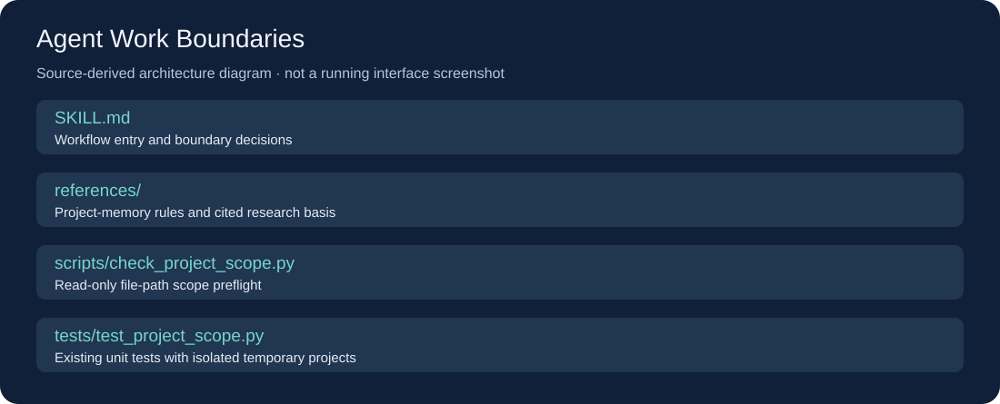

# Agent Work Boundaries

给长期 AI 编程任务划清项目记录、交接、子任务与 Worktree 的边界。它帮助 Agent 把已核实的经验留在正确项目，并用一个只读脚本预检目标文档是否越界。



> 上图根据本仓库实际文件生成，是结构示意图，不是运行界面截图。

## 功能与适用场景

- 项目记忆只写入当前已确认项目，不把外部材料直接升级为项目规则。
- 按任务收益判断是否交接、委派或使用 Worktree。
- 只读路径检查覆盖相邻目录、嵌套 Git 项目、符号链接逃逸及不明确的过大根目录。

## 技术栈

Markdown Skill + Python 3.10 及以上；脚本与测试只使用 Python 标准库，无 pip 依赖。

## 快速上手

### 1. 获取源码

```powershell
git clone https://github.com/yangwei251003/agent-work-boundaries.git
cd agent-work-boundaries
python --version
```

也可以下载 GitHub 的 Code → Download ZIP 后解压。

### 2. 先运行独立示例

```powershell
python scripts/check_project_scope.py --project-root . --target docs/PROJECT_CONTEXT.md --anchor README.md
```

该命令只做只读预检，不安装或驱动任何软件。

### 3. 作为 Skill 使用

把整个仓库目录复制为 `~/.agents/skills/agent-work-boundaries/`，或你的 AI Agent 实际支持的用户 Skill 目录。确保该目录内直接包含 `SKILL.md`。在新任务中明确要求 Agent 读取本技能；自动发现方式以宿主当前文档为准。

普通电脑用户可以直接使用上面的独立命令；完整 Agent 工作流需要支持 Skill 的 AI 编程工具。

## 目录结构

```text
SKILL.md         工作流入口
scripts/         Python/辅助脚本
references/      按需阅读的专项文档
tests/           已有测试或验收材料
docs/            文档配图
LICENSE          自有部分的 MIT 许可
```

## 验证

```powershell
python -X utf8 -m unittest discover -s tests -p "test_*.py" -v
```

当前验证结果与边界见 [VALIDATION.md](VALIDATION.md)。测试使用临时目录，不控制真实桌面，也不更改真实字体或其他系统设置。

## 限制

路径通过只表示目标位于所选根目录内，不证明选对项目、内容真实或用户已授权写入。Skill 本身不会自动保存聊天、调用其他 Agent 或创建 Worktree。

## 更新与规划

见 [CHANGELOG.md](CHANGELOG.md)。这是整理后的开源版本，保留后续维护；不将“测试通过”写成所有宿主都已实测。

## 来源与许可

自有代码与文档采用 [MIT](LICENSE)，外部方法和工具来源见 [PROVENANCE.md](PROVENANCE.md)。不包含私人配置、账号、密钥或依赖缓存。
